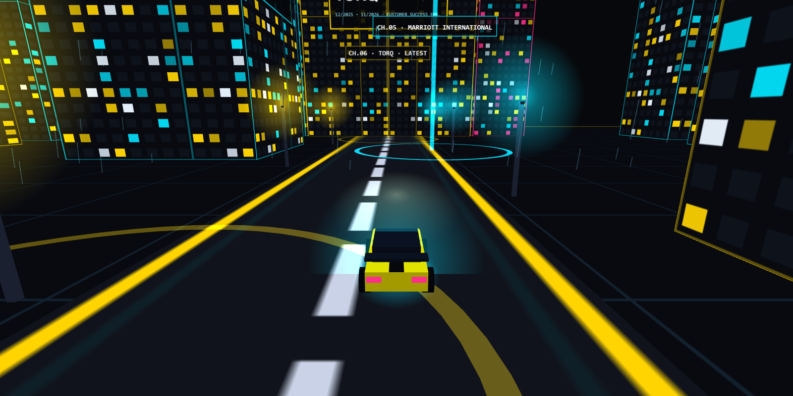
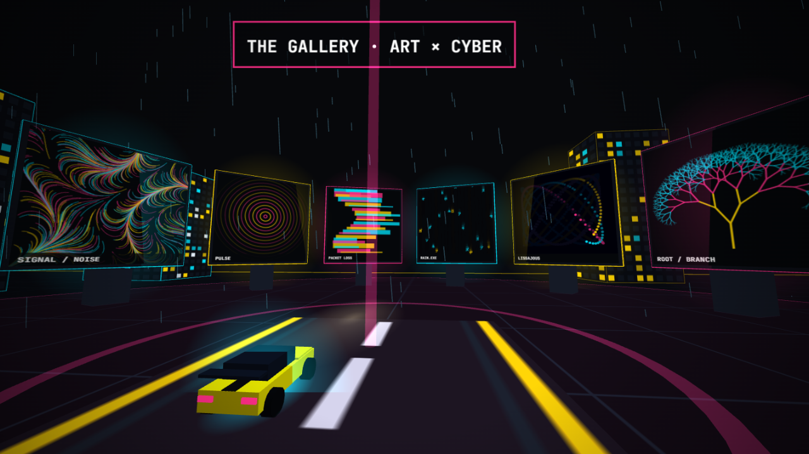

# Drive-Thru Résumé

**A résumé you drive through. One city, one car, every district a chapter.**

A cyber-noir 3D city that runs in your browser. Drive an arcade car down the career timeline, past the skills pylons
and certification ring, through the art gallery, and find the one door that is locked. No install, no build step, no
game engine: just `three.js` and about 700 lines of hand-written physics and world code.

**Live demo:** https://tootenramen.github.io/DriveThru-Resume/

## What's inside

| Path | What it is |
|---|---|
| `index.html` | the page: intro screen, HUD, touch controls, plain-résumé view |
| `game.js` | the whole world: arcade physics, districts, cards, minimap, audio, the puzzle |
| `style.css` | the HUD and cards (black, yellow, cyan, magenta) |
| `data.js` | the résumé as data: edit this one file and the whole city rewrites itself |
| `docs/` | the hero and preview images |

## The city

- **North road: the timeline.** Six career chapters, oldest first, ending at the tower marked LATEST.
- **East: skills and certifications.** Pylons scaled to the skill levels, and a ring of floating cert slabs.
- **West: education and languages.**
- **South: the gallery.** Six generative art pieces drawn by code in your browser: flow field, pulse, glitch, rain, trails, a fractal tree.
- **A locked garage.** There is a terminal near the gallery. Analysts decode things. Contact lives behind the door.

## Use it

1. Open `index.html` through any static server (`python -m http.server` in this folder), or just visit the live demo.
2. Drive: **W A S D** or arrows, **Shift** boost, **Space** drift, **R** reset, **M** sound. On a phone, use the on-screen buttons.
3. In a hurry? **Skip the game: read the résumé** opens a clean, printable plain-HTML résumé.

## Make it yours

The résumé in the demo is the author's. Replace the
values in `data.js` (`name`, `title`, `summary`, `email`, `jobs`, `skills`, `certs`, `edu`, `langs`, `linkedin`, `github`).
The six-job road and the skill pylons are generated from that data. To change the puzzle, edit `SECRET` in `game.js`.

## How it is built

- **Physics:** a velocity-vector arcade model with grip, drift, boost energy, and circle and box collision. No physics library.
- **Look:** lit-window facades from canvas textures, additive glow sprites and neon edge lines, rain, and a CSS vignette. No post-processing pass, so it stays fast on a modest GPU.
- **Sound:** a WebAudio synth engine and chimes, off by default (press **M**).
- **Rendering budget:** about 2.6k triangles and a few hundred draw calls; the world is entirely procedural.

---
Built by [Gustavo Freitas](https://github.com/Tootenramen) - [LinkedIn](https://www.linkedin.com/in/gustavo-freitas-69b93910b/) - [more projects](https://github.com/Tootenramen)
